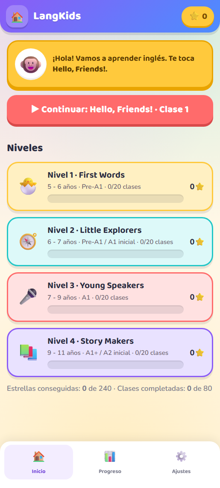
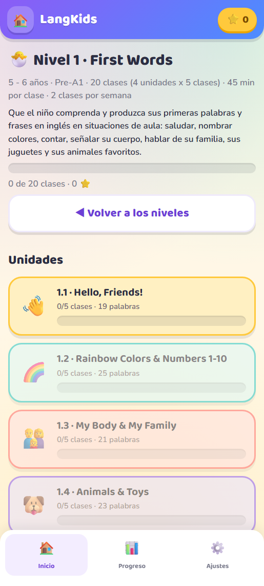
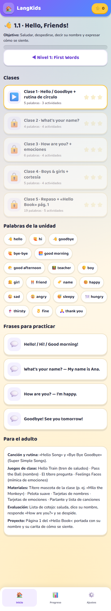
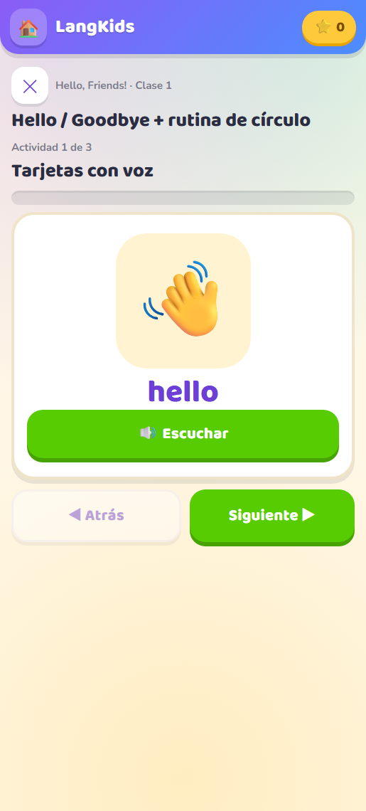

# LangKids English · app Android interactiva

Aplicación para aprender inglés basada en el [plan de temas de LangKids](Plan-de-Temas-LangKids-Niveles-1-a-4.md):
**4 niveles · 16 unidades · 80 clases · 412 palabras**, con voz, juegos y progreso guardado.
Funciona **sin internet** y **no recoge ningún dato**.



---

## 1. Qué hay en este proyecto

| Carpeta / archivo | Qué es |
| --- | --- |
| `Plan-de-Temas-LangKids-Niveles-1-a-4.md` / `.docx` | El currículo completo (fuente del contenido de la app) |
| `docs/Plan-App-LangKids-Android.md` / `.docx` | El plan de desarrollo de la app: alcance, arquitectura, roadmap |
| `docs/Recursos-graficos.md` | Investigación de imágenes gratuitas (licencias, APIs y cómo integrarlas) |
| `docs/img/` | Capturas reales de la app en un Android |
| `app/www/` | La app interactiva en HTML/CSS/JS (también se abre en cualquier navegador) |
| `app/content/lessons.json` | Las 80 clases ya convertidas en datos para la app |
| `app/android/` | El envoltorio Android: manifest, recursos, iconos y `MainActivity.java` |
| `app/tools/` | Scripts que generan contenido, iconos y el APK; y el test automático |
| `app/dist/LangKids-English-1.0.apk` | **El APK firmado y listo para instalar (190 KB)** |

---

## 2. Instalar la app en un teléfono Android

### Opción A · por cable USB (la más rápida para probar)

```powershell
adb install -r app\dist\LangKids-English-1.0.apk
```

### Opción B · sin cable

1. Copia `LangKids-English-1.0.apk` al teléfono (WhatsApp, Drive, correo o cable).
2. Ábrelo desde el explorador de archivos del teléfono.
3. Si Android lo pide, permite *«Instalar apps de origen desconocido»* para esa aplicación.
4. Acepta la instalación. El icono **LangKids English** aparece en el cajón de apps.

### Opción C · sin instalar nada (PWA)

Abre `app/www/index.html` en Chrome para Android y elige **«Añadir a pantalla de inicio»**.
La app web tiene las mismas actividades; la voz la pone el navegador.

> **Voz:** la app usa el motor de voz del teléfono (`com.google.android.tts` suele venir instalado).
> Si el dispositivo no tiene voz en inglés, la app avisa en Ajustes y los juegos siguen funcionando.
> Se instala en *Ajustes → Idioma y entrada de texto → Salida de texto a voz*.

---

## 3. Cómo se usa (para el niño y para el adulto)

| Pantalla | Qué se hace |
| --- | --- |
| **Inicio** | Elige un nivel o toca **Continuar** para ir a la clase que toca |
| **Nivel** | Muestra la meta del nivel y sus 4 unidades con el avance |
| **Unidad** | Objetivo, las 5 clases, el vocabulario de la unidad (se puede tocar para oírlo) y las frases |
| **Clase** | 3 a 5 actividades encadenadas; al terminar, estrellas y celebración |
| **Progreso** | Estrellas (de 240), clases completadas, racha de días e insignias por nivel |
| **Ajustes** | Voz on/off, velocidad de la voz, vibración, reiniciar progreso y aviso de voz |

**Reglas de avance:** cada clase se abre al completar la anterior. Las estrellas dependen de los aciertos al
primer intento (3 = sin errores, 2 = uno o dos, 1 = más). Nunca se pierde progreso por fallar.

**Las 6 actividades:**

1. **Tarjetas con voz** — dibujo + palabra + botón para escucharla.
2. **Escucha y toca** — suena una palabra y hay que elegir el dibujo correcto.
3. **Parejas** — memoria con parejas dibujo/palabra.
4. **Ordena la frase** — tocar las palabras en orden para armar la estructura de la clase.
5. **¿Cuántos son?** — contar dibujos y elegir el número (unidades de números).
6. **Cuestionario de unidad** — repaso mezclado al terminar la clase 5.

---

## 4. Reconstruir todo (si cambias algo)

Requisitos ya presentes en este equipo: Android SDK (`%LOCALAPPDATA%\Android\Sdk`), JDK 17, Node 24 y Python 3.12.

```powershell
# 1) Regenerar el contenido desde el plan de temas (crea lessons.json y lessons.js)
python app\tools\gen_content.py

# 2) Regenerar los iconos (opcional)
python app\tools\make_icons.py

# 3) Compilar y firmar el APK (aapt2 + javac + d8 + zipalign + apksigner)
pwsh -File app\tools\build-apk.ps1

# 4) Pasar el test automático de contenido y progreso (93 comprobaciones)
#    Abre app/tools/selftest.html en Chrome: debe decir "RESULTADO: TODO OK"
```

El APK se firma con la clave de depuración `app/keystore/langkids-debug.jks` (contraseña `langkids`).
Para publicar en Play Store hay que generar una clave propia: ver la sección 12 del plan.

---

## 5. Verificación realizada

| Prueba | Resultado |
| --- | --- |
| Contenido generado desde el plan | 4 niveles · 16 unidades · 80 clases · 412 palabras |
| Test automático (contenido, desbloqueo, estrellas, insignias) | **93 de 93 comprobaciones OK** |
| Sintaxis de los 4 archivos JavaScript | `node --check` sin errores |
| APK firmado y verificado | `apksigner verify` OK · `minSdk 24` · `targetSdk 35` |
| Permisos declarados | solo `VIBRATE` (sin `INTERNET`) |
| Instalación en Android 16 real (emulador) | instalado y abierto correctamente |
| Recorrido de una clase | tarjetas → escucha → acierto que avanza de ronda ✔ |
| Voz del sistema | conectada a `com.google.android.tts` ✔ |

Capturas reales en `docs/img/`:





---

## 6. Diseño y tipografía

El estilo sigue la línea de las apps infantiles de referencia (Lingokids, Duolingo ABC): fondos vivos,
tarjetas gruesas con borde de color, letra enorme y redondeada, botones con relieve 3D y confeti al
completar una clase.

- **Tipografías:** Baloo 2 (títulos y botones) y Nunito (texto), ambas con licencia **OFL** y descargadas
  en local (`app/www/assets/fonts/`). La app no carga fuentes de internet.
- **Arte de las palabras:** emojis del sistema. Son gratuitos, consistentes y pesan 0 KB. El campo `img`
  ya está previsto en el contenido para sustituirlos por ilustraciones cuando se decida.
- **Colores:** cada nivel y cada unidad tiene su propio color (amarillo, turquesa, coral y lila).

## 7. Limitaciones conocidas

- El APK está firmado con clave de **depuración**: sirve para instalar y probar, pero para Play Store se necesita
  una clave de release (documentado en el plan).
- No hay versión iOS ni sincronización en la nube (fuera del alcance de la v1).
- La voz depende del motor TTS del dispositivo; no se incluyen archivos de audio para no inflar el APK.
- Los emojis son el «arte» de la app: en Android se ven a color, en Windows pueden verse monocromos.

## 7. Próximos pasos sugeridos

1. Probar la app con 2-3 niños reales y ajustar la dificultad de las actividades.
2. Añadir audio grabado con voz humana por unidad (opcional, +2 MB).
3. Generar el AAB con `bundletool` y publicar en Google Play (ficha, Data safety, clasificación por edades).
4. Panel del docente con el progreso del grupo (requiere cuentas y backend).
